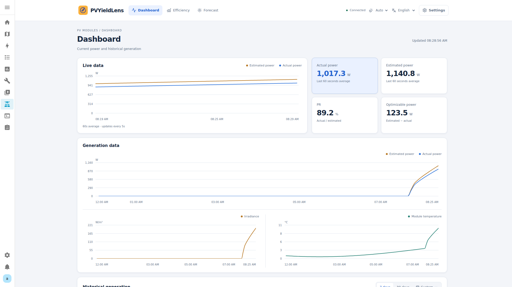
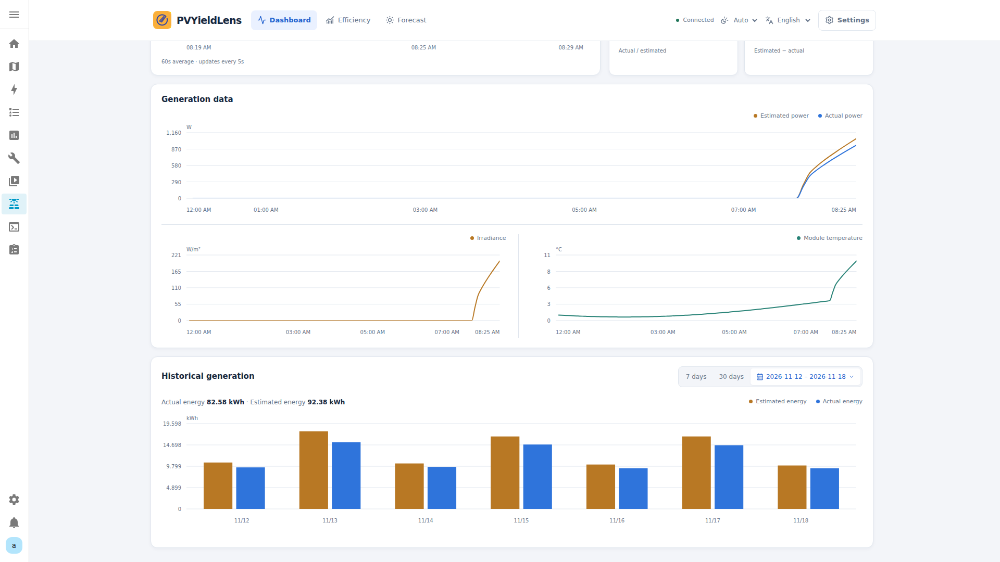

[English](README.md) | [中文](README.zh-CN.md) | [Français](README.fr.md) | **Deutsch** | [Polski](README.pl.md) | [Italiano](README.it.md)

# PVYieldLens

## Überblick

PVYieldLens überwacht die Solarstromerzeugung in Home Assistant. Die App vergleicht die gemessene Leistung mit der Leistung, die bei der aktuellen Sonneneinstrahlung und Modultemperatur zu erwarten wäre. Die Performance Ratio (PR) zeigt, wie viel Prozent des geschätzten Werts Ihre Anlage erreicht. So können Sie die Leistung auch bei wechselndem Wetter vergleichen.

Die App zeigt die aktuelle Leistung und stellt die tatsächliche und die geschätzte Energie für jeden Tag gegenüber. Werte wie der Live-PR und die geschätzte Tagesenergie stehen als Sensoren in Home Assistant zur Verfügung.

Die Ertragsprognose umfasst heute und die nächsten sechs Tage und weist die noch für heute erwartete Energie separat aus. Für PV-Anlagen mit einem einzelnen Wechselrichter bietet PVYieldLens eine Leistungsprognose im CSV-Format, mit der EMHASS den Betrieb von Haushaltsgeräten planen kann. [Über EMHASS](https://emhass.readthedocs.io/en/stable/main_core_concepts.html)

## Installation

### Home Assistant OS

Die App benötigt Home Assistant 2025.9.0 oder neuer.

[](https://my.home-assistant.io/redirect/supervisor_add_addon_repository/?repository_url=https%3A%2F%2Fgithub.com%2Fenecess%2Fha-pvyieldlens%23dev_v0)

1. Klicken Sie oben auf die Schaltfläche und bestätigen Sie **Hinzufügen** in Home Assistant. Zum manuellen Hinzufügen öffnen Sie **Einstellungen > Apps > App installieren > ⋮ > Repositorys** und geben `https://github.com/enecess/ha-pvyieldlens#dev_v0` ein.
2. Suchen Sie **PVYieldLens** im **App-Store** und wählen Sie **Installieren**.
3. Wählen Sie **Starten** und dann **Benutzeroberfläche öffnen**.

Vor Home Assistant 2026.2 öffnen Sie **Einstellungen > Add-ons > Add-on Store** und fügen das Repository über das ⋮-Menü hinzu.

### Docker

Verwenden Sie einen Rechner mit Docker und Compose, der Ihren Home-Assistant-Server erreichen kann.

1. Laden Sie dieses Repository herunter und öffnen Sie den Ordner. Kopieren Sie `.env.example` nach `.env` und setzen Sie Ihr Passwort in `PVYL_WEB_PASSWORD`.
2. Führen Sie `docker compose up -d --build` aus.
3. Öffnen Sie [localhost:8099](http://localhost:8099) auf dem Docker-Host und melden Sie sich als `admin` mit dem gewählten Passwort an.

Für den Zugriff von einem anderen Gerät ändern Sie in `compose.yaml` die Portzuordnung von `127.0.0.1:8099:8099` auf `8099:8099`.

## Konfiguration

Öffnen Sie nach der Installation die **Einstellungen** in PVYieldLens. Über die Abschnittsliste gelangen Sie direkt zu den Einstellungen unten. Halten Sie das Datenblatt Ihrer Solarmodule bereit und prüfen Sie, ob Home Assistant die Erzeugungsleistung und die Sonneneinstrahlung erfasst. Die **Sprache** der Oberfläche können Sie oben rechts ändern.

### Home-Assistant-Verbindung

Die Home-Assistant-App verbindet sich automatisch. Geben Sie bei Docker unter **Home-Assistant-URL** die Adresse ein, die vom Docker-Host aus erreichbar ist, etwa `http://homeassistant.local:8123`.

Öffnen Sie in Home Assistant das Profil eines Administrators und erstellen Sie unter **Sicherheit** ein langlebiges Zugriffstoken. Fügen Sie es in PVYieldLens in das Feld **Langlebiges Zugriffstoken** ein. PVYieldLens benötigt dieses Administratorkonto, um die Ausgabesensoren in Home Assistant zu veröffentlichen. [Kontoeinstellungen in Home Assistant](https://www.home-assistant.io/docs/authentication/#managing-account-access)

Wählen Sie **Entitäten aktualisieren**, um die Verbindung zu prüfen und die Sensorliste zu laden. Geben Sie bei der ersten Einrichtung und nach einem URL-Wechsel ein Token ein. Bei derselben URL können Sie das Feld leer lassen, um das gespeicherte Token weiterzuverwenden.

### PV-Module

| Einstellung | Eingabe |
| --- | --- |
| **Gesamte Maximalleistung unter STC** | Addieren Sie die Nennleistungen der Module unter Standard-Testbedingungen (STC). Zehn Module mit je 500 W ergeben 5.000 W. |
| **Temperaturkoeffizient von Pmax** | Gibt an, wie sich die maximale Leistung je Grad Modultemperatur ändert. Übernehmen Sie den Wert aus dem Datenblatt in %/°C, z. B. −0,35. |
| **Modulneigung** | Geben Sie den Winkel zur Waagerechten ein. Flach bedeutet 0°, senkrecht 90°. |
| **Modulausrichtung** | Wählen Sie die Himmelsrichtung, in die die Module zeigen. Bei **Benutzerdefiniert** zählen Sie im Uhrzeigersinn ab Norden (0°) und geben einen Winkel unter 360° ein. Südost entspricht 135°. |
| **Nominale Zellbetriebstemperatur (NOCT)** | Hilft abzuschätzen, wie warm die Solarzellen werden. Übernehmen Sie den Datenblattwert über 20 °C und bis 80 °C. Der Standardwert beträgt 45 °C. |

Bei fest montierten Modulen wählen Sie **Fester Wert**. Wenn Home Assistant einen Winkel liefert, wählen Sie **HA-Entität** und dann eine Entität `sensor.*`, `number.*` oder `input_number.*` mit der Einheit Grad (°). Sie können für Neigung und Ausrichtung separat entscheiden. Bei einer nachgeführten Anlage liest PVYieldLens die Winkel bei jeder Aktualisierung einmal und verwendet sie für die Prognose aller sieben Tage.


### Sensoren

Suchen Sie die Sensoren Ihrer PV-Anlage in den jeweiligen Feldern nach Namen. Wenn Sie gerade einen Sensor hinzugefügt haben, wählen Sie unter **Home-Assistant-Verbindung** die Option **Entitäten aktualisieren**, um die Liste neu zu laden.

| Einstellung | Sensor und unterstützte Einheiten |
| --- | --- |
| **Tatsächliche Leistung** | Wählen Sie die aktuelle PV-Erzeugungsleistung Ihres Wechselrichters in W oder kW. Der Wert zeigt, wie viel Leistung die Module gerade liefern. |
| **Bestrahlungsstärke** | Wählen Sie den Sensor, der misst, wie viel Sonnenlicht die Module erreicht. Der Sensor sollte dieselbe Neigung und Ausrichtung wie die Module haben und in W/m² oder kW/m² messen. |
| **Modultemperatur (optional)** | Wählen Sie einen Sensor, der die Modultemperatur in °C, °F oder K misst. Ohne Temperatursensor können Sie das Feld leer lassen. PVYieldLens schätzt die Temperatur dann mit der Lufttemperatur von Open-Meteo, der gemessenen Bestrahlungsstärke und der NOCT. |


### Prognose

Prüfen Sie unter **Einstellungen > Prognose** die Angaben **Home-Assistant-Standort**, **Koordinaten** und **Zeitzone des Zuhauses**. PVYieldLens ruft anhand der Koordinaten die Wetterdaten ab. Die Zeitzone bestimmt, wann die Energie eines neuen Tages gezählt wird. Ändern Sie diese Angaben bei Bedarf in Home Assistant.

**PR-Verlauf in Tagen** legt fest, wie viele vergangene Kalendertage die Prognosekorrektur berücksichtigen kann. Der Standardwert beträgt 14 Tage. Sie können 3 bis 90 Tage einstellen.

### Überwachung

Wählen Sie **Überwachung**, um die Optionen zu öffnen. Für die erste Einrichtung können Sie die Voreinstellungen übernehmen.

- **Abrechnungsintervall** legt fest, wie oft PVYieldLens Energie und PR für den gerade beendeten Zeitraum berechnet und speichert. Standardmäßig geschieht das alle 5 Minuten. Zur Auswahl stehen auch 1 oder 10 Minuten.
- **Mittelwert über** gibt an, wie weit PVYieldLens für die Live-Mittelwerte zurückblickt. Der Standardwert beträgt 60 Sekunden. Ein längerer Zeitraum glättet kurze Schwankungen in der Live-Kurve.
- **Update alle** legt fest, wie oft neue Werte in der Live-Ansicht erscheinen. Der Standardwert beträgt 5 Sekunden.
- **Zeit ohne neue Daten** gibt an, wie lange PVYieldLens den letzten Messwert eines Sensors verwenden darf. Ist die Zeit abgelaufen, bleibt der Zeitraum ohne frischen Messwert bei der Berechnung von Leistung, Energie und PR außen vor.

Wählen Sie **Konfiguration speichern**. Wenn **Konfiguration gespeichert** angezeigt wird, öffnen Sie die **Übersicht** und prüfen Sie die Live-Werte. Die Tagesdiagramme füllen sich, sobald die Ergebnisse der beendeten Zeitabschnitte gespeichert werden.

## Ergebnisse

### Übersicht

Oben sehen Sie **Tatsächliche Leistung**, **Geschätzte Leistung** und **PR**. Die **Optimierbare Leistung** ist geschätzte minus tatsächliche Leistung in Watt. Ist der Wert negativ, liegt die tatsächliche Leistung über der Schätzung. Unter **Live-Daten** sehen Sie beide Leistungskurven der letzten zehn Minuten.



Unter **Ertragsdaten** können Sie die heutige Leistung zusammen mit der Sonneneinstrahlung und der Modultemperatur betrachten. Jeder Punkt steht für einen beendeten und gespeicherten Zeitraum. Fehlen für einen ganzen Zeitraum die nötigen Messwerte, bleibt eine Lücke. Wenn die erforderlichen Messwerte vorliegen und der Leistungssensor null meldet, erscheint eine Null.


Unter **Bisheriger Energieertrag** können Sie die tatsächliche und die geschätzte Energie in kWh für jeden Tag vergleichen. Wählen Sie **7 Tage**, **30 Tage** oder **Benutzerdefiniert**. Der benutzerdefinierte Zeitraum kann bis zu 90 Kalendertage umfassen und endet spätestens heute.

Für die letzten sieben vollständigen Tage wählen Sie **Benutzerdefiniert** und setzen das **Enddatum** auf gestern. Wählen Sie als **Startdatum** den Tag sechs Tage zuvor und klicken Sie auf **Anwenden**. Beide Tage zählen mit.




### Effizienz

Wählen Sie oben unter **Effizienz** den gewünschten Zeitraum. **Heute** vergleicht den PR von heute bis zur aktuellen Uhrzeit mit dem PR von gestern bis zur gleichen Uhrzeit. Um 12 Uhr vergleicht die Ansicht beispielsweise jeweils die erste Tageshälfte. **24 Stunden** reicht von jetzt 24 Stunden zurück. **7 Tage** und **30 Tage** folgen den Kalendertagen in der Home-Assistant-Zeitzone und schließen heute ein.

**PR im Zeitraum** zeigt, wie viel Prozent der geschätzten Energie Ihre Module im gewählten Zeitraum erzeugt haben. **PR-Änderung zur Vorperiode** zeigt die Differenz in Prozentpunkten. Ein Rückgang von 90 % auf 87 % entspricht beispielsweise 3 Prozentpunkten. **Geschätzte − tatsächliche Energie** zeigt die Differenz in kWh.

In der Ansicht **Heute** sehen Sie im **PR-Verlauf**, wann sich die Leistung geändert hat. Unter **Ertragsvergleich** können Sie beide Leistungskurven für die gleichen Zeiten prüfen. Bei **7 Tage** und **30 Tage** können Sie mit **Tägliche Zusammenfassung** einzelne Tage vergleichen. Für Änderungen innerhalb eines Tages wechseln Sie zu **Alle 5 Minuten** oder zu dem Intervall, das Sie unter **Überwachung** gewählt haben.


#### Berechnung des PR

PVYieldLens passt zuerst die Nennleistung der Module an ihre Temperatur und die auf die Module treffende Sonneneinstrahlung an. Anschließend vergleicht es die gemessene Leistung oder Energie mit der Schätzung.

```text
Geschätzte Leistung = P_STC × [1 + (K / 100) × (T − 25)] × (G / 1000)
Live-PR = Tatsächliche Leistung ÷ Geschätzte Leistung × 100%
PR im Zeitraum = Tatsächliche Energie ÷ Geschätzte Energie × 100%
```

| Symbol | Wert |
| --- | --- |
| `P_STC` | **Gesamte Maximalleistung unter STC** (W) |
| `K` | **Temperaturkoeffizient von Pmax** (%/°C). Geben Sie den Wert aus dem Datenblatt ein, z. B. −0,35. |
| `T` | Gemessene oder geschätzte **Modultemperatur** (°C) |
| `G` | **Bestrahlungsstärke** in der Modulebene (W/m²) |

Für den Live-PR mittelt die **Übersicht** beide Leistungswerte über die gleiche Zeit. Für den **PR im Zeitraum** summiert **Effizienz** die tatsächliche und geschätzte Energie ebenfalls über die gleiche Zeit. Wenn zum Beispiel in einem Fünf-Minuten-Abschnitt nur für vier Minuten alle nötigen Messwerte vorliegen, gehen dieselben vier Minuten in beide Energiewerte ein.

Bei 5.000 W Anlagenleistung, `K = −0,35`, `T = 45 °C` und `G = 800 W/m²` beträgt die geschätzte Leistung **3.720 W**. Bei **3.348 W** tatsächlicher Leistung beträgt der PR **90 %**.

Liegt der tatsächliche Wert über der Schätzung, kann der PR größer als 100 % sein. Ist die geschätzte Leistung oder Energie null oder fehlen die nötigen Messwerte, erscheint für den PR **—**.

### Prognose

Die **Ursprüngliche Prognose** schätzt den Ertrag für heute und die nächsten sechs Tage. Sie verwendet die von Open-Meteo vorhergesagte Sonneneinstrahlung und Lufttemperatur sowie die Einstellungen Ihrer Module.

Die **Korrigierte Prognose** passt die ursprüngliche Prognose daran an, wie viel Energie Ihre Module an vergangenen Tagen im Vergleich zur Schätzung tatsächlich erzeugt haben. Jüngere Tage zählen stärker. PVYieldLens braucht mindestens drei vergangene Tage mit beiden Energiewerten und einer geschätzten Energie über null. Solange diese Daten noch gesammelt werden, können Sie die ursprüngliche Prognose verwenden. Die korrigierten Werte zeigen **—**.

**Heute verbleibend** zeigt die erwartete Energie von jetzt bis Mitternacht. Mit der **Prognose für morgen** können Sie den nächsten Tag planen. Unter **Tägliche Energieprognose** deckt **Heute** den ganzen Tag ab. Die **Summe für 7 Tage** umfasst alle sieben Kalendertage. Wählen Sie **Prognose aktualisieren**, um neue Wetterdaten anzufordern.


Wählen Sie ein Datum aus, um den Zeitpunkt der höchsten erwarteten Leistung zu finden und die ursprüngliche und korrigierte Leistungskurve zu vergleichen. Öffnen Sie unter dem Diagramm die **15-Minuten-Details** für Leistung, Energie, Bestrahlungsstärke und Temperaturen in jedem Zeitabschnitt.


#### Export zu EMHASS

Wenn Sie EMHASS mit einem einzelnen PV-Wechselrichter verwenden, können Sie die prognostizierte Leistung für einen Optimierungslauf exportieren.

1. Wählen Sie **CSV exportieren**. Wählen Sie unter **Prognosereihe** die ursprüngliche oder korrigierte Prognose.
2. Stimmen Sie **Startdatum**, **Startzeit**, **Optimierungsintervall** und **Optimierungsschritte** auf den Lauf ab. Prüfen Sie in der Vorschau, ob der Export den gewünschten Zeitraum umfasst.
3. Wählen Sie **Herunterladen** und legen Sie `data_weather_forecast.csv` im EMHASS-Verzeichnis `data_path` ab. Setzen Sie in EMHASS `set_use_pv=true` und `weather_forecast_method=csv`. [EMHASS-Einrichtung](pvyieldlens/DOCS.md#export-a-pv-power-forecast-to-emhass)


### Ausgabesensoren in Home Assistant

Nach der Einrichtung veröffentlicht PVYieldLens die folgenden Sensoren in Home Assistant. Sie können zum Beispiel den Live-PR auf einem Dashboard anzeigen oder mit der morgigen Prognose den Betrieb eines Geräts automatisieren.

| Messgröße | HA-Entitätsname | Einheit |
| --- | --- | --- |
| Abgerechnete geschätzte Leistung | `settled_estimated_power` | W |
| Abgerechnete tatsächliche Leistung | `settled_actual_power` | W |
| Abgerechneter PR | `settled_pr` | % |
| Geschätzte Energie heute | `estimated_energy_today` | kWh |
| Geschätzte Energie insgesamt | `estimated_energy_lifetime` | kWh |
| Geschätzte Live-Leistung | `live_estimated_power` | W |
| Tatsächliche Live-Leistung | `live_actual_power` | W |
| Live-PR | `live_pr` | % |
| Optimierbare Live-Leistung | `live_optimizable_power` | W |
| Prognostizierte Energie heute | `forecast_energy_today` | kWh |
| Prognostizierte Energie für den Rest des Tages | `forecast_energy_remaining_today` | kWh |
| Prognostizierte Energie morgen | `forecast_energy_tomorrow` | kWh |
| Prognostizierte Energie für 7 Tage | `forecast_energy_7d` | kWh |

Die Tabelle zeigt die Anzeigenamen in Home Assistant. Verwenden Sie in Automatisierungen die vollständige ID, z. B. `sensor.pvyieldlens_settled_estimated_power`. Die abgerechneten Sensorwerte beziehen sich auf den zuletzt gespeicherten Abschnitt. Die Live-Sensoren folgen den Mittelwerten der **Übersicht**.

Die geschätzte Tagesenergie startet um Mitternacht in der Zeitzone des Zuhauses bei null. Der Gesamtwert zählt ab der Ersteinrichtung. Die vier Prognosesensoren melden die Energie der **Ursprünglichen Prognose** in kWh. Ihre Werte können sich mit einer neuen Prognose ändern.
