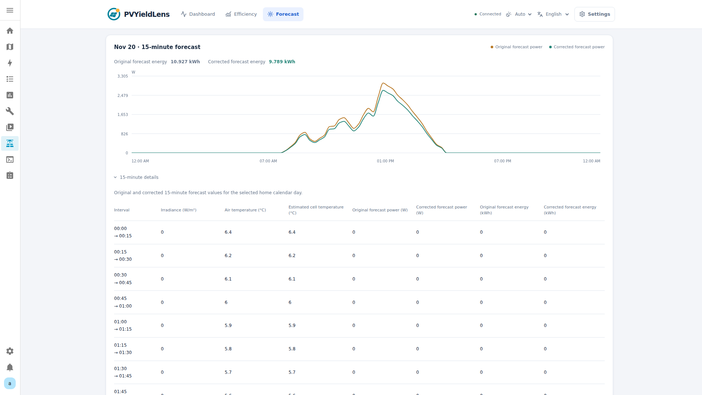

[English](README.md) | [中文](README.zh-CN.md) | **Français** | [Deutsch](README.de.md) | [Polski](README.pl.md) | [Italiano](README.it.md)

# PVYieldLens

## Vue d’ensemble

PVYieldLens suit la production de vos panneaux solaires dans Home Assistant. L’application compare la puissance mesurée avec la puissance attendue selon l’ensoleillement et la température des panneaux. Le ratio de performance (PR) indique quel pourcentage de la puissance estimée votre installation atteint. Vous pouvez ainsi comparer ses performances même quand le temps change.

L’application affiche la puissance actuelle, compare jour par jour l’énergie produite et l’énergie estimée, et fournit des capteurs Home Assistant pour des valeurs telles que le PR en direct et l’énergie estimée du jour.

La prévision de production couvre aujourd’hui et les six prochains jours. Elle donne aussi l’énergie encore attendue d’ici la fin de la journée. Pour les installations équipées d’un seul onduleur photovoltaïque, PVYieldLens fournit une prévision de puissance au format CSV qu’EMHASS peut utiliser pour planifier le fonctionnement des appareils du foyer. [À propos d’EMHASS](https://emhass.readthedocs.io/en/stable/main_core_concepts.html)

## Installation

### Home Assistant OS

L’application nécessite Home Assistant 2025.9.0 ou une version ultérieure.

[](https://my.home-assistant.io/redirect/supervisor_add_addon_repository/?repository_url=https%3A%2F%2Fgithub.com%2Fenecess%2Fha-pvyieldlens)

1. Utilisez le bouton ci-dessus, puis confirmez avec **Ajouter** dans Home Assistant. Pour ajouter le dépôt manuellement, ouvrez **Paramètres > Applications > Installer une application > ⋮ > Dépôts** et saisissez `https://github.com/enecess/ha-pvyieldlens`.
2. Recherchez **PVYieldLens** dans le **Magasin d'applications** et sélectionnez **Installer**.
3. Sélectionnez **Démarrer**, puis **Ouvrir l'interface utilisateur web**.

Avant Home Assistant 2026.2, ouvrez **Paramètres > Modules complémentaires > Boutique des modules complémentaires**, puis ajoutez le dépôt depuis le menu ⋮.

### Docker

Utilisez une machine équipée de Docker et de Compose qui peut accéder à votre serveur Home Assistant.

1. Téléchargez ce dépôt et ouvrez son dossier. Copiez `.env.example` vers `.env` et choisissez un mot de passe dans `PVYL_WEB_PASSWORD`.
2. Exécutez `docker compose up -d --build`.
3. Sur la machine qui héberge Docker, ouvrez [localhost:8099](http://localhost:8099). Connectez-vous avec le compte `admin` et le mot de passe choisi.

Pour accéder à l’application depuis un autre appareil, remplacez `127.0.0.1:8099:8099` par `8099:8099` dans `compose.yaml`.

## Configuration

Après l’installation, ouvrez les **Paramètres** de PVYieldLens. La liste des sections permet d’accéder directement aux réglages ci-dessous. Préparez la fiche technique de vos panneaux et vérifiez que Home Assistant dispose de capteurs pour leur puissance et l’ensoleillement. Vous pouvez modifier la langue de l’interface avec le menu **Langue** en haut à droite.

### Connexion Home Assistant

L’application Home Assistant se connecte automatiquement. Avec Docker, saisissez dans **Adresse Home Assistant** l’adresse accessible depuis la machine qui héberge Docker, par exemple `http://homeassistant.local:8123`.

Dans Home Assistant, ouvrez le profil d’un administrateur et créez un jeton d’accès de longue durée dans **Sécurité**. Collez-le dans **Jeton d’accès de longue durée** dans PVYieldLens. Les droits d’administrateur permettent à PVYieldLens de publier les capteurs de sortie. [Paramètres du compte Home Assistant](https://www.home-assistant.io/docs/authentication/#managing-account-access)

Sélectionnez **Actualiser les entités** pour vérifier la connexion et charger la liste des capteurs. Saisissez un jeton lors de la première configuration ou lors d’un changement d’adresse. Si l’adresse reste la même, vous pouvez laisser le champ vide pour réutiliser le jeton enregistré.

### Modules photovoltaïques

| Paramètre | Valeur à saisir |
| --- | --- |
| **Puissance maximale totale aux STC** | Additionnez les puissances nominales des modules en conditions d’essai standard (STC). Dix modules de 500 W totalisent 5 000 W. |
| **Coefficient de température de Pmax** | Indique de combien varie la puissance maximale pour chaque degré de température des panneaux. Saisissez la valeur de la fiche technique en %/°C, par exemple −0,35. |
| **Inclinaison des modules** | Indiquez l’angle par rapport à l’horizontale. À plat, l’angle vaut 0°. À la verticale, il vaut 90°. |
| **Orientation des modules** | Choisissez la direction vers laquelle les panneaux sont tournés. Avec **Personnalisé**, comptez dans le sens horaire à partir du nord (0°) et entrez un angle inférieur à 360°. Le sud-est correspond à 135°. |
| **Température nominale de fonctionnement des cellules (NOCT)** | Sert à estimer à quelle température les cellules vont chauffer. Saisissez la valeur de la fiche technique, supérieure à 20 °C et jusqu’à 80 °C. La valeur par défaut est de 45 °C. |

Pour des panneaux fixes, choisissez **Valeur fixe**. Si Home Assistant fournit un angle, choisissez **Entité HA**, puis une entité `sensor.*`, `number.*` ou `input_number.*` qui donne cet angle en degrés (°). Vous pouvez choisir séparément pour l’inclinaison et l’orientation. Avec un suiveur solaire, chaque actualisation relève une seule fois les angles du moment et les utilise pour les sept jours de prévision.


### Capteurs

Dans chaque champ, recherchez le capteur de votre installation par son nom. Si vous venez d’ajouter un capteur, sélectionnez **Actualiser les entités** dans **Connexion Home Assistant** pour mettre la liste à jour.

| Paramètre | Capteur et unités prises en charge |
| --- | --- |
| **Puissance réelle** | Choisissez la puissance photovoltaïque fournie par votre onduleur en W ou kW. Cette mesure indique la puissance produite par les panneaux à cet instant. |
| **Irradiance** | Choisissez le capteur qui mesure la quantité de lumière reçue par les panneaux, en W/m² ou kW/m². Le capteur doit être installé avec la même inclinaison et la même orientation que les panneaux. |
| **Température des modules (facultative)** | Choisissez un capteur qui mesure la température des panneaux en °C, °F ou K. Si vous n’en avez pas, laissez ce champ vide. PVYieldLens estime alors cette température à partir de la température de l’air d’Open-Meteo, de l’irradiance mesurée et de la NOCT. |


### Prévisions

Dans **Paramètres > Prévisions**, vérifiez le **Lieu Home Assistant**, les **Coordonnées** et le **Fuseau horaire du domicile**. Les coordonnées servent à récupérer la météo locale. Le fuseau horaire fixe la limite de chaque journée à minuit. Faites les changements nécessaires dans Home Assistant.

**Jours d’historique PR** fixe le nombre de jours passés que la prévision corrigée peut prendre en compte. La valeur par défaut est de 14 jours. Vous pouvez choisir une durée entre 3 et 90 jours.

### Surveillance

Sélectionnez **Surveillance** pour ouvrir les réglages. Vous pouvez conserver les valeurs par défaut lors de la première configuration.

- **Intervalle de règlement** détermine à quelle fréquence PVYieldLens calcule et enregistre l’énergie et le PR pour la période qui vient de se terminer. Par défaut, cela se fait toutes les 5 minutes. Vous pouvez aussi choisir 1 ou 10 minutes.
- **Moyenne sur** fixe la durée prise en compte dans les moyennes en direct. Par défaut, PVYieldLens utilise les 60 dernières secondes. Une durée plus longue atténue les variations brèves sur le graphique en direct.
- **Mise à jour toutes les** fixe la fréquence d’actualisation des valeurs en direct. Par défaut, elles sont mises à jour toutes les 5 secondes.
- **Délai sans données** indique combien de temps PVYieldLens peut utiliser la dernière mesure d’un capteur. Quand le délai est dépassé, l’application exclut des calculs de puissance, d’énergie et de PR le temps passé sans nouvelle mesure.

Sélectionnez **Enregistrer la configuration**. Quand **Configuration enregistrée** s’affiche, ouvrez le **Tableau de bord** et vérifiez les valeurs en direct. Les graphiques du jour se remplissent au fur et à mesure que les résultats sont enregistrés à la fin de chaque période.

## Résultats

### Tableau de bord

Les cartes du haut affichent la **Puissance réelle**, la **Puissance estimée** et le **PR**. La **Puissance optimisable** correspond à la puissance estimée moins la puissance réelle, en watts. Une valeur négative signifie que la puissance réelle dépasse l’estimation. Dans **Données en direct**, suivez les deux courbes sur les dix dernières minutes.


Dans **Données de production**, suivez la puissance du jour en parallèle de l’ensoleillement et de la température des panneaux. Chaque point correspond à une période terminée dont les valeurs ont été enregistrées. Si aucune mesure ne permet le calcul sur toute une période, le graphique laisse un blanc. Quand les mesures nécessaires sont disponibles et que le capteur de puissance indique zéro, le graphique affiche zéro.


Dans **Historique de production**, comparez en kWh l’énergie réelle et l’énergie estimée pour chaque jour. Choisissez **7 jours**, **30 jours** ou **Personnalisé**. Une période personnalisée peut couvrir jusqu’à 90 jours et se terminer au plus tard aujourd’hui.

Pour voir les sept derniers jours complets, choisissez **Personnalisé** et saisissez la date d’hier dans **Date de fin**. Indiquez une **Date de début** six jours plus tôt, puis sélectionnez **Appliquer**. Les deux dates sont incluses dans la période.


### Efficacité

Choisissez une période en haut de la page **Efficacité**. **Aujourd’hui** compare le PR d’aujourd’hui jusqu’à l’heure actuelle au PR d’hier jusqu’à la même heure. Par exemple, à midi, la comparaison porte sur la première moitié de chaque journée. **24 heures** couvre les 24 dernières heures. **7 jours** et **30 jours** suivent le calendrier dans le fuseau horaire de Home Assistant et incluent la journée en cours.

Le **PR sur la période** indique quel pourcentage de l’énergie estimée vos panneaux ont produit sur la période choisie. La **Variation du PR depuis la période précédente** donne la différence en points de pourcentage. Par exemple, passer de 90 % à 87 % correspond à une baisse de 3 points. **Énergie estimée − réelle** indique l’écart en kWh.

Dans la vue **Aujourd’hui**, repérez quand le PR a changé dans **Évolution du PR**, puis consultez les deux courbes de puissance aux mêmes heures dans **Comparaison de production**. Pour **7 jours** et **30 jours**, choisissez **Résumé quotidien** pour comparer les totaux par jour. Pour voir à quel moment un changement est survenu, sélectionnez **Toutes les 5 minutes** ou la durée que vous avez définie sous **Surveillance**.


#### Calcul du PR

PVYieldLens ajuste d’abord la puissance nominale des panneaux en fonction de leur température et de la lumière qu’ils reçoivent. L’application compare ensuite cette estimation à la puissance mesurée ou à l’énergie produite.

```text
Puissance estimée = P_STC × [1 + (K / 100) × (T − 25)] × (G / 1000)
PR en direct = Puissance réelle ÷ Puissance estimée × 100%
PR sur la période = Énergie réelle ÷ Énergie estimée × 100%
```

| Symbole | Valeur |
| --- | --- |
| `P_STC` | **Puissance maximale totale aux STC** (W) |
| `K` | **Coefficient de température de Pmax** (%/°C). Saisissez la valeur de la fiche technique, par exemple −0,35. |
| `T` | **Température des modules** (°C), mesurée ou estimée |
| `G` | **Irradiance** dans le plan des modules (W/m²) |

Pour le PR en direct, le **Tableau de bord** calcule la moyenne des deux puissances sur les mêmes plages horaires. Pour le **PR sur la période**, la page **Efficacité** cumule les deux valeurs d’énergie sur les mêmes plages horaires. Par exemple, si les mesures nécessaires ne sont disponibles que pendant quatre minutes sur cinq, le calcul des deux valeurs d’énergie porte sur ces quatre minutes.

Une installation de 5 000 W avec `K = −0,35`, `T = 45 °C` et `G = 800 W/m²` a une puissance estimée de **3 720 W**. Si la puissance réelle est de **3 348 W**, le PR est de **90 %**.

Le PR peut dépasser 100 % si la production réelle est supérieure à l’estimation. Si la puissance ou l’énergie estimée est nulle, ou si les mesures nécessaires ne sont pas disponibles, le PR affiche **—**.

### Prévisions

La **Prévision originale** estime la production d’aujourd’hui et des six prochains jours à partir de l’ensoleillement et de la température de l’air prévus par Open-Meteo, ainsi que des paramètres de vos panneaux.

La **Prévision corrigée** ajuste la prévision originale en comparant ce que vos panneaux ont réellement produit aux estimations des derniers jours. Les jours les plus récents comptent davantage. PVYieldLens a besoin d’au moins trois jours passés pour lesquels les deux valeurs d’énergie sont disponibles et où l’énergie estimée est supérieure à zéro. En attendant, vous pouvez utiliser la prévision originale et les valeurs corrigées affichent **—**.

La carte **Reste aujourd’hui** donne l’énergie attendue d’ici minuit. **Prévision de demain** vous aide à planifier la journée suivante. Dans **Énergie prévue par jour**, **Aujourd’hui** couvre la journée entière et le **Total sur 7 jours** inclut les sept jours. Sélectionnez **Actualiser les prévisions** pour demander une mise à jour météo.


Sélectionnez une date pour repérer quand la production devrait être la plus forte et comparer les courbes de puissance originale et corrigée. Ouvrez **Détails par 15 minutes** sous le graphique pour voir la puissance, l’énergie, l’irradiance et les températures de chaque intervalle.



#### Exporter vers EMHASS

Si vous utilisez EMHASS avec un seul onduleur photovoltaïque, vous pouvez exporter la prévision de puissance pour une optimisation.

1. Sélectionnez **Exporter le CSV**. Dans **Série de puissance prévue**, choisissez la prévision originale ou corrigée.
2. Réglez **Date de début**, **Heure de début**, **Intervalle d’optimisation** et **Nombre de pas d’optimisation** en fonction de votre calcul. Vérifiez dans l’aperçu que l’export couvre la période à optimiser.
3. Sélectionnez **Télécharger**, puis placez `data_weather_forecast.csv` dans le dossier `data_path` d’EMHASS. Dans EMHASS, réglez `set_use_pv=true` et `weather_forecast_method=csv`. [Configuration d’EMHASS](pvyieldlens/DOCS.md#export-a-pv-power-forecast-to-emhass)


### Capteurs de sortie Home Assistant

Après la configuration, PVYieldLens publie les capteurs suivants dans Home Assistant. Vous pouvez par exemple afficher le PR en direct dans un tableau de bord ou utiliser la prévision de demain dans une automatisation pour planifier quand lancer un appareil.

| Mesure | Nom de l’entité HA | Unité |
| --- | --- | --- |
| Puissance estimée après clôture | `settled_estimated_power` | W |
| Puissance réelle après clôture | `settled_actual_power` | W |
| PR après clôture | `settled_pr` | % |
| Énergie estimée aujourd’hui | `estimated_energy_today` | kWh |
| Énergie estimée cumulée | `estimated_energy_lifetime` | kWh |
| Puissance estimée en direct | `live_estimated_power` | W |
| Puissance réelle en direct | `live_actual_power` | W |
| PR en direct | `live_pr` | % |
| Puissance optimisable en direct | `live_optimizable_power` | W |
| Énergie prévue aujourd’hui | `forecast_energy_today` | kWh |
| Énergie prévue pour le reste de la journée | `forecast_energy_remaining_today` | kWh |
| Énergie prévue demain | `forecast_energy_tomorrow` | kWh |
| Énergie prévue sur sept jours | `forecast_energy_7d` | kWh |

Le tableau reprend les noms affichés dans Home Assistant. Dans les automatisations, utilisez l’identifiant complet, par exemple `sensor.pvyieldlens_settled_estimated_power`. Les capteurs après clôture affichent les résultats de la dernière période enregistrée. Les capteurs en direct suivent les moyennes du **Tableau de bord**.

L’énergie estimée du jour repart de zéro à minuit dans le fuseau horaire du domicile. Le cumul commence à la première configuration. Les quatre capteurs de prévision indiquent l’énergie de la **Prévision originale** en kWh. Leurs valeurs peuvent changer quand la prévision est mise à jour.
