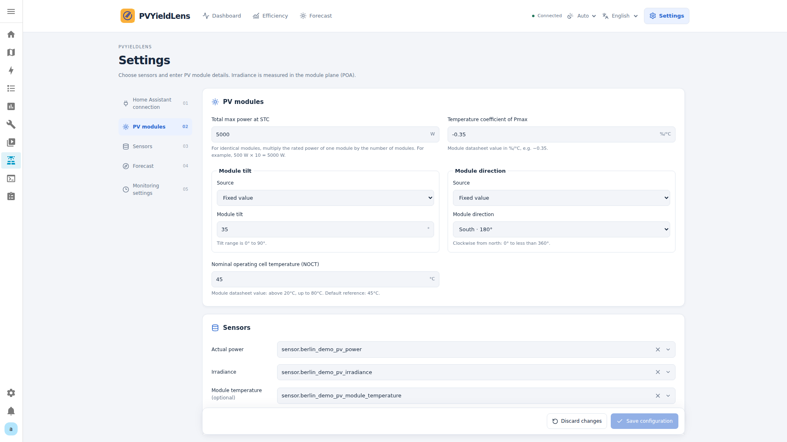
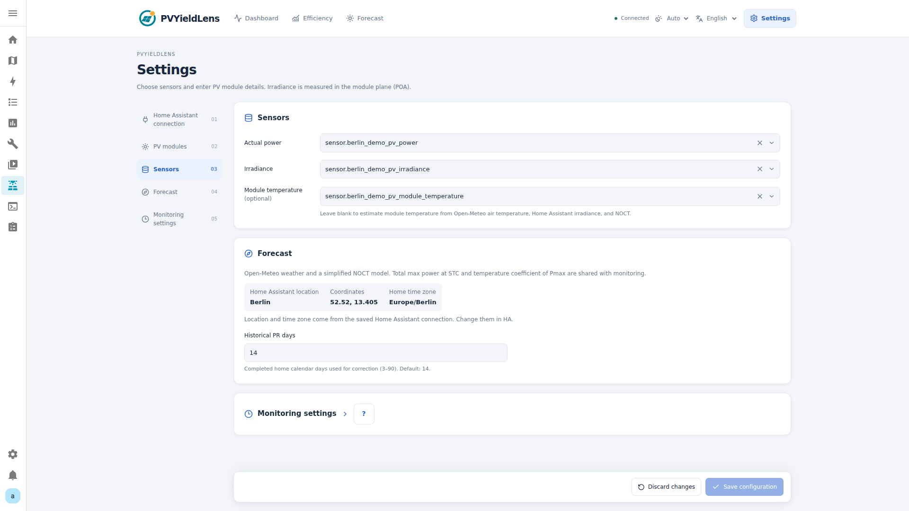

[English](README.md) | [中文](README.zh-CN.md) | [Français](README.fr.md) | [Deutsch](README.de.md) | [Polski](README.pl.md) | **Italiano**

# PVYieldLens

## Panoramica del progetto

PVYieldLens monitora la produzione fotovoltaica in Home Assistant. Confronta la potenza misurata dai sensori con quella attesa in base alla luce che arriva sui pannelli e alla loro temperatura. L’indice di prestazione (PR) indica quale percentuale del valore stimato raggiunge il tuo impianto. Questo aiuta a confrontare le prestazioni con condizioni meteo diverse.

L’app mostra la potenza in tempo reale, confronta l’energia prodotta e quella stimata giorno per giorno e rende disponibili in Home Assistant sensori come il PR in tempo reale e l’energia stimata per oggi.

La previsione copre oggi e i prossimi sei giorni e indica quanta energia è ancora prevista entro la fine della giornata. Per gli impianti con un solo inverter fotovoltaico, PVYieldLens offre una previsione di potenza in formato CSV che EMHASS può usare per pianificare il funzionamento degli apparecchi di casa. [Informazioni su EMHASS](https://emhass.readthedocs.io/en/stable/main_core_concepts.html)

## Installazione

### Home Assistant OS

L’app richiede Home Assistant 2025.9.0 o una versione successiva.

[](https://my.home-assistant.io/redirect/supervisor_add_addon_repository/?repository_url=https%3A%2F%2Fgithub.com%2Fenecess%2Fha-pvyieldlens)

1. Usa il pulsante qui sopra e conferma con **Aggiungi** in Home Assistant. Per aggiungere il repository a mano, apri **Impostazioni > Applicazioni > Installa app > ⋮ > Archivi digitali** e inserisci `https://github.com/enecess/ha-pvyieldlens`.
2. Cerca **PVYieldLens** nella **Raccolta delle app** e seleziona **Installa**.
3. Seleziona **Avvia**, poi **Apri interfaccia utente Web**.

Prima di Home Assistant 2026.2, apri **Impostazioni > Componenti aggiuntivi > Negozio dei componenti aggiuntivi** e aggiungi il repository dal menu ⋮.

### Docker

Usa un computer con Docker e Compose che possa raggiungere il server Home Assistant.

1. Scarica il repository e apri la cartella. Copia `.env.example` in `.env` e imposta la password in `PVYL_WEB_PASSWORD`.
2. Esegui `docker compose up -d --build`.
3. Sul computer che esegue Docker, apri [localhost:8099](http://localhost:8099) e accedi come `admin` con la password scelta.

Per accedere da un altro dispositivo, cambia la mappatura delle porte in `compose.yaml` da `127.0.0.1:8099:8099` a `8099:8099`.

## Configurazione

Dopo l’installazione, apri **Impostazioni** in PVYieldLens. L’elenco delle sezioni permette di raggiungere le opzioni descritte qui sotto. Tieni a portata di mano la scheda tecnica dei pannelli e verifica che Home Assistant riceva le misure di potenza e di luce solare. Il menu **Lingua** in alto a destra cambia la lingua dell’interfaccia.

### Connessione a Home Assistant

L’app Home Assistant si collega automaticamente. Con Docker, inserisci in **URL di Home Assistant** l’indirizzo raggiungibile dal computer che ospita Docker, per esempio `http://homeassistant.local:8123`.

In Home Assistant, apri il profilo di un amministratore e crea un token di accesso a lunga durata in **Sicurezza**. Incollalo in **Token di accesso a lunga durata** in PVYieldLens. I permessi di amministratore consentono all’app di pubblicare i sensori di uscita. [Impostazioni dell’account Home Assistant](https://www.home-assistant.io/docs/authentication/#managing-account-access)

Seleziona **Aggiorna entità** per verificare la connessione e caricare l’elenco dei sensori. Inserisci il token la prima volta che configuri l’app o quando cambi l’URL. Se l’URL resta lo stesso, puoi lasciare vuoto il campo per usare il token salvato.

### Moduli fotovoltaici

| Impostazione | Valore da inserire |
| --- | --- |
| **Potenza massima totale in STC** | Somma le potenze nominali dei moduli in condizioni di prova standard (STC). Dieci moduli da 500 W danno 5.000 W. |
| **Coefficiente di temperatura di Pmax** | Indica come cambia la potenza massima per ogni grado di temperatura dei moduli. Inserisci il valore della scheda tecnica in %/°C, per esempio −0,35. |
| **Inclinazione dei moduli** | Indica l’angolo rispetto all’orizzontale. Un pannello orizzontale è a 0°, uno verticale a 90°. |
| **Orientamento dei moduli** | Scegli la direzione verso cui sono rivolti i moduli. Con **Personalizzato**, inserisci un angolo inferiore a 360°, misurato in senso orario a partire dal nord (0°). Il sud-est è a 135°. |
| **Temperatura nominale di funzionamento della cella (NOCT)** | Serve a stimare quanto si riscaldano le celle solari. Inserisci il valore della scheda tecnica, superiore a 20 °C e fino a 80 °C. Il valore predefinito è 45 °C. |

Per i pannelli montati ad angolo fisso, scegli **Valore fisso**. Se Home Assistant fornisce un angolo, scegli **Entità HA** e seleziona un’entità `sensor.*`, `number.*` o `input_number.*` che lo riporti in gradi (°). Puoi fare questa scelta separatamente per inclinazione e orientamento. Se i pannelli seguono il sole, a ogni aggiornamento l’app legge una sola volta gli angoli del momento e li usa per tutti i sette giorni della previsione.



### Sensori

Cerca il sensore dell’impianto per nome in ciascun campo. Se hai appena aggiunto un sensore, seleziona **Aggiorna entità** in **Connessione a Home Assistant** per aggiornare l’elenco.

| Impostazione | Sensore e unità supportate |
| --- | --- |
| **Potenza effettiva** | Scegli la potenza fotovoltaica dell’inverter in W o kW. La misura indica la potenza che i pannelli stanno producendo in quel momento. |
| **Irradianza** | Scegli il sensore che misura la luce solare ricevuta dai pannelli, in W/m² o kW/m². Il sensore dovrebbe avere la stessa inclinazione e lo stesso orientamento dei pannelli. |
| **Temperatura dei moduli (facoltativa)** | Scegli un sensore che misuri la temperatura dei pannelli in °C, °F o K. Se non ne hai uno, lascia il campo vuoto. PVYieldLens stima la temperatura usando la temperatura dell’aria fornita da Open-Meteo, l’irradianza misurata e la NOCT. |



### Previsioni

In **Impostazioni > Previsioni**, controlla **Posizione Home Assistant**, **Coordinate** e **Fuso orario di casa**. Le coordinate indicano all’app dove recuperare le previsioni meteo. Il fuso orario stabilisce la mezzanotte in cui si passa ai totali del nuovo giorno. Puoi modificare questi dati in Home Assistant.

**Giorni di storico PR** stabilisce quanti giorni passati possono essere considerati per la previsione corretta. L’impostazione predefinita è 14 giorni. Puoi scegliere da 3 a 90 giorni.

### Monitoraggio

Seleziona **Monitoraggio** per aprire le opzioni. Alla prima configurazione puoi usare i valori predefiniti.

- **Intervallo di contabilizzazione** stabilisce ogni quanto PVYieldLens calcola e salva l’energia e il PR del periodo appena terminato. Il valore predefinito è 5 minuti. Puoi scegliere anche 1 o 10 minuti.
- **Media su** stabilisce quanto indietro nel tempo prendere le misure per calcolare le medie in tempo reale. Il valore predefinito è 60 secondi. Una durata maggiore attenua le variazioni brevi nel grafico.
- **Aggiorna ogni** stabilisce la frequenza di aggiornamento dei valori in tempo reale. Il valore predefinito è 5 secondi.
- **Tempo senza nuovi dati** indica per quanto tempo l’app può usare l’ultima misura di un sensore. Scaduto quel tempo, l’app esclude il periodo senza una nuova misura dai calcoli di potenza, energia e PR.

Seleziona **Salva configurazione**. Quando appare **Configurazione salvata**, apri **Panoramica** e controlla i valori in tempo reale. I grafici della giornata si popolano man mano che l’app salva i risultati dei periodi completati.

## Risultati

### Panoramica

Le schede in alto mostrano **Potenza effettiva**, **Potenza stimata** e **PR**. La **Potenza ottimizzabile** è la potenza stimata meno quella effettiva, in watt. Un valore negativo indica che la potenza effettiva supera la stima. In **Dati in tempo reale** puoi seguire entrambe le curve di potenza degli ultimi dieci minuti.


In **Dati di produzione** puoi osservare come la potenza di oggi è cambiata insieme alla luce solare e alla temperatura dei pannelli. Ogni punto corrisponde a un periodo terminato i cui risultati sono stati salvati. Se per un intero periodo mancano le misure necessarie al calcolo, il grafico lascia uno spazio vuoto. Quando le misure necessarie sono disponibili e il sensore di potenza indica zero, il grafico mostra zero.


In **Produzione storica** puoi confrontare giorno per giorno l’energia effettiva e quella stimata in kWh. Seleziona **7 giorni**, **30 giorni** o **Personalizzato**. L’intervallo personalizzato può comprendere fino a 90 giorni di calendario e terminare al massimo oggi.

Per vedere gli ultimi sette giorni completi, seleziona **Personalizzato** e imposta ieri come **Data finale**. Come **Data iniziale**, scegli la data di sei giorni prima, poi seleziona **Applica**. Entrambe le date sono comprese nell’intervallo.


### Efficienza

Scegli il periodo in alto nella pagina **Efficienza**. **Oggi** confronta il PR di oggi fino all’ora corrente con il PR di ieri fino alla stessa ora. Per esempio, a mezzogiorno il confronto riguarda la prima metà di entrambe le giornate. **24 ore** copre le ultime 24 ore. **7 giorni** e **30 giorni** seguono il calendario nel fuso orario di Home Assistant e comprendono la giornata in corso.

Il **PR nel periodo** mostra quale percentuale dell’energia stimata è stata prodotta dai pannelli nel periodo selezionato. **Variazione PR dal periodo precedente** indica la differenza in punti percentuali. Per esempio, passare dal 90% all’87% significa scendere di 3 punti percentuali. **Energia stimata − effettiva** indica la differenza in kWh.

In **Oggi**, usa **Andamento PR** per individuare quando è cambiata la prestazione, poi controlla entrambe le curve di potenza in **Confronto produzione** per quegli orari. Per **7 giorni** e **30 giorni**, usa **Riepilogo giornaliero** per confrontare i totali dei singoli giorni. Per vedere a che ora si è verificato un cambiamento, passa a **Ogni 5 minuti** o all’intervallo scelto in **Monitoraggio**.


#### Calcolo del PR

PVYieldLens adatta la potenza nominale dei pannelli alla loro temperatura e alla quantità di luce che ricevono. Confronta poi la stima con la potenza o l’energia effettiva.

```text
Potenza stimata = P_STC × [1 + (K / 100) × (T − 25)] × (G / 1000)
PR in tempo reale = Potenza effettiva ÷ Potenza stimata × 100%
PR nel periodo = Energia effettiva ÷ Energia stimata × 100%
```

| Simbolo | Valore |
| --- | --- |
| `P_STC` | **Potenza massima totale in STC** (W) |
| `K` | **Coefficiente di temperatura di Pmax** (%/°C). Inserisci il valore della scheda tecnica, per esempio −0,35. |
| `T` | **Temperatura dei moduli** (°C), misurata o stimata |
| `G` | **Irradianza** sul piano dei moduli (W/m²) |

Per il PR in tempo reale, **Panoramica** calcola la media delle due potenze sullo stesso periodo. Per il **PR nel periodo**, **Efficienza** somma l’energia effettiva e quella stimata usando gli stessi intervalli di tempo. Per esempio, se in un periodo di cinque minuti le misure necessarie sono disponibili per quattro minuti, entrambe le energie usano quegli stessi quattro minuti.

Un impianto da 5.000 W con `K = −0,35`, `T = 45 °C` e `G = 800 W/m²` ha una potenza stimata di **3.720 W**. Se la potenza effettiva è **3.348 W**, il PR è **90%**.

Il PR può superare il 100% quando la produzione effettiva supera la stima. Se la potenza o l’energia stimata è zero, oppure mancano le misure necessarie al confronto, il PR mostra **—**.

### Previsioni

La **Previsione originale** stima la produzione di oggi e dei prossimi sei giorni. Usa la luce solare e la temperatura dell’aria previste da Open-Meteo insieme alle impostazioni dei pannelli.

La **Previsione corretta** adatta quella originale confrontando l’energia che i pannelli hanno prodotto con la stima negli ultimi giorni. I giorni più recenti contano di più. Servono almeno tre giorni passati con entrambi i valori disponibili e con l’energia stimata sopra zero. Nel frattempo puoi usare la previsione originale e i valori corretti mostrano **—**.

**Rimanente oggi** mostra l’energia attesa da adesso a mezzanotte. **Previsione di domani** aiuta a pianificare la giornata successiva. In **Energia prevista per giorno**, **Oggi** copre l’intera giornata e il **Totale di 7 giorni** comprende tutti e sette i giorni. Seleziona **Aggiorna previsione** per richiedere nuovi dati meteo.


Seleziona una data per individuare l’orario di massima produzione attesa e confrontare le curve di potenza originale e corretta. Sotto il grafico, apri **Dettagli ogni 15 minuti** per vedere potenza, energia, irradianza e temperature per ogni intervallo.


#### Esportazione in EMHASS

Se usi EMHASS con un solo inverter fotovoltaico, puoi esportare la previsione di potenza per un’ottimizzazione.

1. Seleziona **Esporta CSV**. In **Serie della potenza prevista**, scegli la previsione originale o quella corretta.
2. Imposta **Data di inizio**, **Ora di inizio**, **Intervallo di ottimizzazione** e **Passi di ottimizzazione** in base al calcolo da eseguire. Controlla nell’anteprima che l’esportazione copra il periodo da ottimizzare.
3. Seleziona **Scarica** e sposta `data_weather_forecast.csv` nella cartella `data_path` di EMHASS. In EMHASS, imposta `set_use_pv=true` e `weather_forecast_method=csv`. [Configurazione di EMHASS](pvyieldlens/DOCS.md#export-a-pv-power-forecast-to-emhass)


### Sensori di uscita in Home Assistant

Dopo la configurazione, PVYieldLens pubblica i sensori qui sotto in Home Assistant. Per esempio, puoi aggiungere il PR in tempo reale a una dashboard o usare la previsione di domani in un’automazione che pianifica l’avvio di un apparecchio.

| Metrica | Nome entità HA | Unità |
| --- | --- | --- |
| Potenza stimata contabilizzata | `settled_estimated_power` | W |
| Potenza effettiva contabilizzata | `settled_actual_power` | W |
| PR contabilizzato | `settled_pr` | % |
| Energia stimata oggi | `estimated_energy_today` | kWh |
| Energia stimata cumulativa | `estimated_energy_lifetime` | kWh |
| Potenza stimata in tempo reale | `live_estimated_power` | W |
| Potenza effettiva in tempo reale | `live_actual_power` | W |
| PR in tempo reale | `live_pr` | % |
| Potenza ottimizzabile in tempo reale | `live_optimizable_power` | W |
| Energia prevista oggi | `forecast_energy_today` | kWh |
| Energia prevista per il resto di oggi | `forecast_energy_remaining_today` | kWh |
| Energia prevista domani | `forecast_energy_tomorrow` | kWh |
| Energia prevista in 7 giorni | `forecast_energy_7d` | kWh |

La tabella mostra i nomi visualizzati in Home Assistant. Nelle automazioni usa l’ID completo, per esempio `sensor.pvyieldlens_settled_estimated_power`. I sensori contabilizzati mostrano i risultati dell’ultimo periodo salvato. I sensori in tempo reale seguono le medie in **Panoramica**.

L’energia stimata di oggi si azzera a mezzanotte nel fuso orario di casa. L’energia stimata cumulativa parte dalla prima configurazione. I quattro sensori di previsione riportano l’energia della **Previsione originale** in kWh. I valori possono cambiare quando la previsione si aggiorna.
