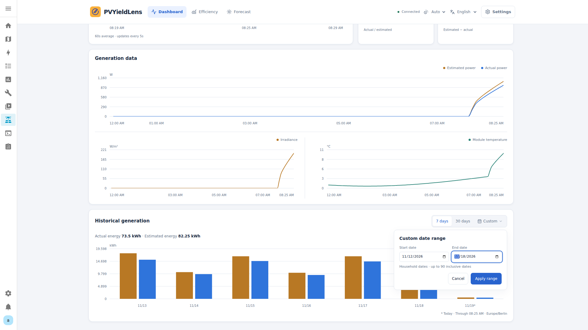
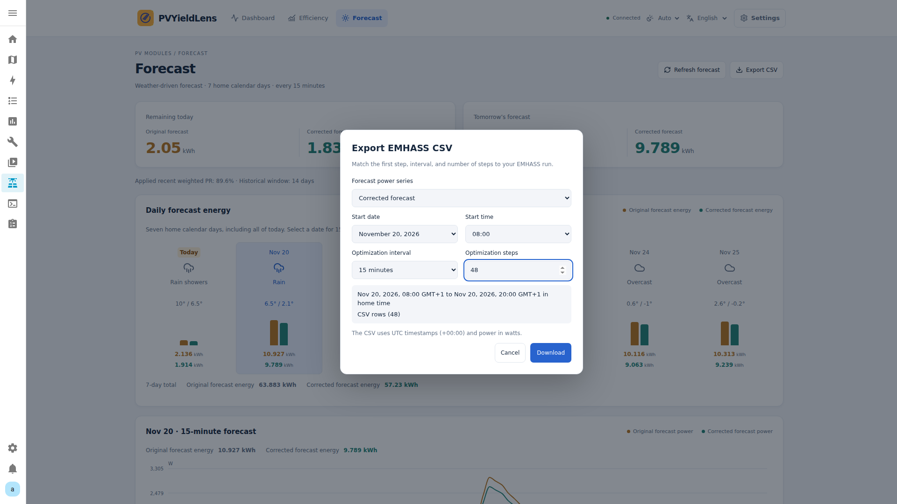

**English** | [中文](README.zh-CN.md) | [Français](README.fr.md) | [Deutsch](README.de.md) | [Polski](README.pl.md) | [Italiano](README.it.md)

# PVYieldLens

## Overview

PVYieldLens monitors solar generation in Home Assistant. It compares the power measured by your sensors with the power your panels are expected to produce at their current temperature and in the sunlight they receive. The performance ratio (PR) shows what percentage of that estimate your system achieves, so you can compare performance as conditions change.

The app shows current power, compares actual and estimated energy day by day, and provides readings such as live PR and today’s estimated energy as Home Assistant sensors.

The generation forecast covers today and the next six days, with a separate estimate for the energy still expected today. For solar systems with a single inverter, PVYieldLens offers a CSV power forecast that EMHASS can use to plan when to run household appliances. [About EMHASS](https://emhass.readthedocs.io/en/stable/main_core_concepts.html)

## Install

### Home Assistant OS

The App requires Home Assistant 2025.9.0 or newer.

[](https://my.home-assistant.io/redirect/supervisor_add_addon_repository/?repository_url=https%3A%2F%2Fgithub.com%2Fenecess%2Fha-pvyieldlens)

1. Use the button above and confirm **Add** in Home Assistant. To add the repository manually, open **Settings > Apps > Install app > ⋮ > Repositories** and enter `https://github.com/enecess/ha-pvyieldlens`.
2. Find **PVYieldLens** in the **App store** and select **Install**.
3. Select **Start**, then **Open Web UI**.

Before Home Assistant 2026.2, open **Settings > Add-ons > Add-on store**, then use the ⋮ menu to add the repository.

### Docker

Run PVYieldLens on a Docker host with Compose that can reach your Home Assistant server.

1. Download this repository and open its folder. Copy `.env.example` to `.env` and set `PVYL_WEB_PASSWORD` to your chosen password.
2. Run `docker compose up -d --build`.
3. On the Docker host, open [localhost:8099](http://localhost:8099) and sign in as `admin` with that password.

To allow access from another device, change the port mapping in `compose.yaml` from `127.0.0.1:8099:8099` to `8099:8099`.

## Configure

After installation, open **Settings** in PVYieldLens. Use the section list to find the settings below. You’ll need your solar panel specifications and the Home Assistant sensors that report generation power and sunlight. Use **Language** at the top right if you want to change the interface language.

### Home Assistant connection

The Home Assistant App connects automatically. For Docker, fill in **Home Assistant URL** with an address your Docker host can reach, such as `http://homeassistant.local:8123`. Use your own Home Assistant address and port.

In Home Assistant, open the administrator’s profile, go to **Security**, and create a long-lived access token. Paste it into **Long-lived access token** in PVYieldLens. The administrator account lets PVYieldLens publish its output sensors. [Home Assistant account settings](https://www.home-assistant.io/docs/authentication/#managing-account-access)

Select **Refresh entities** to check the connection and load the available sensors. Enter a token on first setup or when changing the URL. While keeping the same URL, you can leave the field blank to reuse the saved token.

### PV modules

| Setting | What to enter |
| --- | --- |
| **Total max power at STC** | Add up the rated wattage of your panels under standard test conditions (STC). Ten 500 W panels total 5,000 W. |
| **Temperature coefficient of Pmax** | Indicates how rated power changes for each degree of panel temperature. Enter the datasheet value in %/°C, for example −0.35. |
| **Module tilt** | Enter the angle above horizontal. Flat is 0° and vertical is 90°. |
| **Module direction** | Choose the compass direction your panels face. For **Custom**, count clockwise from north (0°) and enter an angle below 360°. For example, southeast is 135°. |
| **Nominal operating cell temperature (NOCT)** | Used to estimate how warm the solar cells get. Enter the datasheet value above 20 °C and up to 80 °C. The default is 45 °C. |

For panels mounted at a fixed angle, choose **Fixed value**. If Home Assistant reports an angle, select **HA entity** and pick a `sensor.*`, `number.*` or `input_number.*` that reports degrees (°). You can make this choice separately for tilt and direction. If you use a solar tracker, each forecast update reads its current angles once and uses them for all seven days.


### Sensors

Choose the sensors that measure your solar installation in Home Assistant. Search for them by name. If you just added a sensor, select **Refresh entities** under **Home Assistant connection** to update the list.

| Setting | Sensor and supported units |
| --- | --- |
| **Actual power** | Select your inverter’s current solar production in W or kW. This reading tells the app how much power the panels are producing at that moment. |
| **Irradiance** | Select the sensor that measures how much sunlight reaches the panels, in W/m² or kW/m². It should measure at the same tilt and facing direction as the panels. |
| **Module temperature (optional)** | Select a sensor that measures the panels’ temperature in °C, °F or K. If you don’t have one, leave the field blank. PVYieldLens then estimates it using Open-Meteo air temperature, your irradiance sensor and the NOCT setting. |


### Forecast

Under **Forecast** in **Settings**, check **Home Assistant location**, **Coordinates** and **Home time zone**. The coordinates tell PVYieldLens where to get weather data. The time zone determines when one day’s totals end and the next day’s begin. If they need updating, make the changes in Home Assistant.

**Historical PR days** sets how many previous calendar days to look back when correcting the forecast. The default is 14 days, and you can choose between 3 and 90.

### Monitoring settings

Select **Monitoring settings** to expand the controls. You can keep the defaults when setting up the app.

- **Settlement interval** sets how often PVYieldLens calculates and saves energy and PR for the period that just ended. The default is 5 minutes. You can also select 1 or 10 minutes.
- **Average over** sets how much recent data to use for the live averages. The default is 60 seconds. A longer average makes brief changes in the live chart less pronounced.
- **Update every** sets how often new values appear in the live view. The default is 5 seconds.
- **Data timeout** sets how long the app can use a sensor’s last reading. When that time runs out, the app leaves the time without a fresh reading out of the power, energy and PR calculations.

Select **Save configuration**. After you see **Configuration saved**, open **Dashboard** to check the live values. The day’s charts fill in as monitoring periods finish and their results are saved.

## What you get

### Dashboard

The cards at the top show your current **Actual power** and **Estimated power** alongside **PR**. **Optimizable power** is estimated power minus actual power in watts. A negative value means actual power is higher than estimated. In **Live data**, follow the two power curves over the last ten minutes.


Use **Generation data** to see how today’s production changed alongside sunlight and panel temperature. Each point shows a period that has finished and been saved. A period with no usable readings leaves a gap in the chart. When the required readings are available and the sensor reports zero generation, the chart shows zero.


In **Historical generation**, compare actual and estimated energy in kWh, day by day. Choose **7 days**, **30 days**, or **Custom** to choose up to 90 calendar days ending no later than today.

To see the last seven complete days, select **Custom** and set **End date** to yesterday. Set **Start date** to six days before that, then select **Apply range**. Both dates count toward the seven days.




### Efficiency

Choose the time range at the top of **Efficiency**. **Today** compares today’s PR so far with yesterday’s PR at the same time. For example, at noon the comparison uses the first half of each day. **24 hours** looks back 24 hours from now. **7 days** and **30 days** use calendar days in the Home Assistant time zone and include today.

The **PR in range** card shows the share of estimated energy that your panels produced in the selected time. **PR change from previous period** shows the difference in percentage points. For example, a change from 90% to 87% is a drop of 3 percentage points. **Estimated − actual energy** shows the difference in kWh.

In the **Today** view, use **PR trend** to see when performance changed and **Generation comparison** to check the two power curves at those times. For **7 days** and **30 days**, use **Daily summary** to compare daily totals. To see when a change happened within a day, switch to **Every 5 minutes** or the interval you set in **Monitoring settings**.


#### How PR is calculated

PVYieldLens first adjusts the rated power of the panels for their temperature and how much sunlight is reaching them. It then compares that estimate with your measured power or energy.

```text
Estimated power = P_STC × [1 + (K / 100) × (T − 25)] × (G / 1000)
Live PR = Actual power ÷ Estimated power × 100%
PR in range = Actual energy ÷ Estimated energy × 100%
```

| Symbol | Value |
| --- | --- |
| `P_STC` | **Total max power at STC** (W) |
| `K` | **Temperature coefficient of Pmax** (%/°C). Enter the datasheet value, e.g. −0.35. |
| `T` | **Module temperature** (°C), measured or estimated |
| `G` | **Irradiance** in the plane of the modules (W/m²) |

For live PR, **Dashboard** averages actual and estimated power over the same time. For **PR in range**, **Efficiency** adds up actual and estimated energy over the same time. For example, if the required readings are available for only four minutes of a five-minute period, both values use those four minutes.

A 5,000 W array with `K = −0.35`, `T = 45 °C` and `G = 800 W/m²` has an estimated power of **3,720 W**. If actual power is **3,348 W**, PR is **90%**.

PR can go above 100% when actual output is higher than estimated. PR shows **—** if the estimated power or energy is zero, or if there are no usable readings to compare.

### Forecast

**Original forecast** estimates generation for today and the next six days. It uses the sunlight and air temperature forecast by Open-Meteo, along with your panel settings.

**Corrected forecast** adjusts the original forecast based on how much energy your panels actually produced compared with the estimate on recent days. More recent days count more. PVYieldLens needs at least three previous days with both energy values available and estimated energy above zero. While it gathers history, you can use the original forecast and the corrected values show **—**.

Use **Remaining today** for the energy expected from now until midnight, or **Tomorrow’s forecast** to plan for tomorrow. Under **Daily forecast energy**, the **Today** card covers the full day and the **7-day total** includes all seven dates. Select **Refresh forecast** to request fresh weather data.


Select a date to see when production is expected to be highest and compare the original and corrected power curves. Open **15-minute details** below the chart for the power, energy, irradiance and temperatures for each part of the day.


#### Export to EMHASS

If you use EMHASS with a single PV inverter, you can export the forecast power for an optimization run.

1. Select **Export CSV** and choose the original or corrected forecast in **Forecast power series**.
2. Set **Start date**, **Start time**, **Optimization interval** and **Optimization steps** to match the run. Check that the preview covers the time you want to optimize.
3. Select **Download** and put `data_weather_forecast.csv` in EMHASS’s `data_path` folder. In EMHASS, use `set_use_pv=true` and `weather_forecast_method=csv`. [EMHASS setup details](pvyieldlens/DOCS.md#export-a-pv-power-forecast-to-emhass)



### Home Assistant output sensors

Once configured, PVYieldLens publishes the sensors below in Home Assistant. For example, add live PR to a dashboard card, or use tomorrow’s forecast in an automation that schedules when to run an appliance.

| Metric | HA entity name | Unit |
| --- | --- | --- |
| Settled estimated power | `settled_estimated_power` | W |
| Settled actual power | `settled_actual_power` | W |
| Settled PR | `settled_pr` | % |
| Estimated energy today | `estimated_energy_today` | kWh |
| Lifetime estimated energy | `estimated_energy_lifetime` | kWh |
| Live estimated power | `live_estimated_power` | W |
| Live actual power | `live_actual_power` | W |
| Live PR | `live_pr` | % |
| Live optimizable power | `live_optimizable_power` | W |
| Forecast energy today | `forecast_energy_today` | kWh |
| Forecast energy remaining today | `forecast_energy_remaining_today` | kWh |
| Forecast energy tomorrow | `forecast_energy_tomorrow` | kWh |
| Forecast energy for 7 days | `forecast_energy_7d` | kWh |

The table shows the display names in Home Assistant. Use the full ID in automations, for example `sensor.pvyieldlens_settled_estimated_power`. The settled sensors show the latest saved period, while the live sensors follow the averages on **Dashboard**.

Estimated energy for today resets at midnight in your Home Assistant time zone. Lifetime estimated energy adds up from initial setup. The four forecast sensors show **Original forecast** energy in kWh and can change when the forecast is updated.
