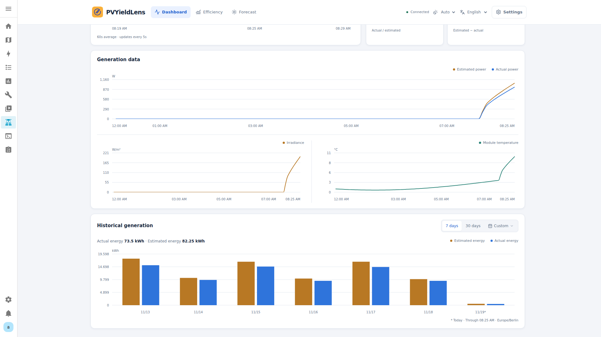
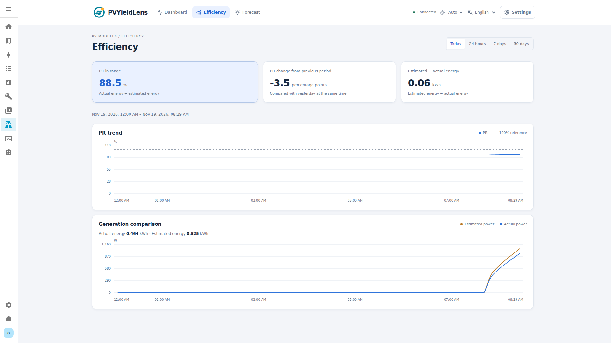

[English](README.md) | [中文](README.zh-CN.md) | [Français](README.fr.md) | [Deutsch](README.de.md) | **Polski** | [Italiano](README.it.md)

# PVYieldLens

## Przegląd

PVYieldLens monitoruje produkcję fotowoltaiczną w Home Assistant. Aplikacja porównuje zmierzoną moc z mocą oczekiwaną przy aktualnym nasłonecznieniu i temperaturze paneli. Współczynnik wydajności (PR) pokazuje, jaki procent szacowanej mocy osiąga instalacja. Dzięki temu można porównywać jej pracę także wtedy, gdy zmienia się pogoda.

Aplikacja pokazuje bieżącą moc i porównuje energię rzeczywistą z szacowaną dzień po dniu. Wartości takie jak bieżący PR i energia szacowana na dziś są dostępne jako czujniki w Home Assistant.

Prognoza produkcji obejmuje dzisiaj i kolejnych sześć dni. Osobno pokazuje, ile energii powinno jeszcze powstać do końca dnia. Dla instalacji z jednym falownikiem fotowoltaicznym PVYieldLens udostępnia prognozę mocy w formacie CSV, z której EMHASS może skorzystać do planowania pracy urządzeń domowych. [O EMHASS](https://emhass.readthedocs.io/en/stable/main_core_concepts.html)

## Instalacja

### Home Assistant OS

Aplikacja wymaga Home Assistant 2025.9.0 lub nowszego.

[](https://my.home-assistant.io/redirect/supervisor_add_addon_repository/?repository_url=https%3A%2F%2Fgithub.com%2Fenecess%2Fha-pvyieldlens)

1. Użyj przycisku powyżej i potwierdź wybór przyciskiem **Dodaj** w Home Assistant. Aby dodać repozytorium ręcznie, otwórz **Ustawienia > Aplikacje > Zainstaluj aplikację > ⋮ > Repozytoria** i wpisz `https://github.com/enecess/ha-pvyieldlens`.
2. Znajdź **PVYieldLens** na stronie **Sklep z aplikacjami** i wybierz **Zainstaluj**.
3. Wybierz **Uruchom**, a następnie **Otwórz interfejs użytkownika**.

Przed wersją Home Assistant 2026.2 otwórz **Ustawienia > Dodatki > Sklep z dodatkami**, a następnie dodaj repozytorium z menu ⋮.

### Docker

Użyj komputera z Dockerem i Compose, który ma dostęp do serwera Home Assistant.

1. Pobierz repozytorium i otwórz jego folder. Skopiuj `.env.example` do `.env` i ustaw hasło w `PVYL_WEB_PASSWORD`.
2. Uruchom `docker compose up -d --build`.
3. Na hoście Dockera otwórz [localhost:8099](http://localhost:8099). Zaloguj się jako `admin` przy użyciu ustawionego hasła.

Aby uzyskać dostęp z innego urządzenia, zmień mapowanie portów w `compose.yaml` z `127.0.0.1:8099:8099` na `8099:8099`.

## Konfiguracja

Po instalacji otwórz **Ustawienia** w PVYieldLens. Lista sekcji prowadzi do ustawień opisanych poniżej. Przygotuj kartę katalogową paneli i sprawdź, czy Home Assistant odbiera pomiary mocy produkcji i natężenia światła słonecznego. Menu **Język** w prawym górnym rogu pozwala zmienić język interfejsu.

### Połączenie z Home Assistant

Aplikacja Home Assistant łączy się automatycznie. W Dockerze w polu **Adres Home Assistant** wpisz adres dostępny z hosta Dockera, np. `http://homeassistant.local:8123`.

W Home Assistant otwórz profil administratora i w sekcji **Bezpieczeństwo** utwórz długoterminowy token dostępu. Wklej go w polu **Długoterminowy token dostępu** w PVYieldLens. Uprawnienia administratora pozwalają aplikacji publikować czujniki wynikowe. [Ustawienia konta Home Assistant](https://www.home-assistant.io/docs/authentication/#managing-account-access)

Wybierz **Odśwież encje**, aby sprawdzić połączenie i wczytać listę czujników. Podaj token przy pierwszej konfiguracji lub przy zmianie adresu. Przy tym samym adresie możesz pozostawić pole puste, aby użyć zapisanego tokena.

### Moduły fotowoltaiczne

| Ustawienie | Wartość do wpisania |
| --- | --- |
| **Łączna moc maksymalna w STC** | Zsumuj znamionowe moce paneli w standardowych warunkach testowych (STC). Dziesięć paneli po 500 W daje 5 000 W. |
| **Współczynnik temperaturowy Pmax** | Określa, jak zmienia się moc maksymalna wraz z temperaturą paneli. Wpisz wartość z karty katalogowej w %/°C, np. −0,35. |
| **Nachylenie modułów** | Podaj kąt względem poziomu. Moduł położony płasko ma kąt 0°, a zamontowany pionowo 90°. |
| **Kierunek modułów** | Wybierz kierunek, w którym zwrócone są panele. Przy opcji **Własny** podaj kąt mniejszy niż 360°, liczony od północy (0°) zgodnie z ruchem wskazówek zegara. Południowy wschód to 135°. |
| **Nominalna temperatura pracy ogniwa (NOCT)** | Służy do oszacowania temperatury ogniw podczas pracy. Wpisz wartość z karty katalogowej, powyżej 20 °C i do 80 °C. Domyślna wartość to 45 °C. |

Dla paneli zamontowanych na stałe wybierz **Wartość stała**. Jeśli Home Assistant podaje kąt, wybierz **Encja HA**, a potem encję `sensor.*`, `number.*` lub `input_number.*`, która podaje wartość w stopniach (°). Możesz wybrać źródło osobno dla nachylenia i kierunku. Jeśli panele obracają się za słońcem, przy każdym odświeżeniu prognozy aplikacja odczytuje ich aktualne kąty raz i stosuje je we wszystkich siedmiu dniach prognozy.


### Czujniki

W każdym polu wyszukaj odpowiedni czujnik instalacji po nazwie. Jeśli właśnie dodano czujnik, wybierz **Odśwież encje** w sekcji **Połączenie z Home Assistant**, aby zaktualizować listę.

| Ustawienie | Czujnik i obsługiwane jednostki |
| --- | --- |
| **Moc rzeczywista** | Wybierz odczyt bieżącej mocy fotowoltaicznej z falownika w W lub kW. Pokazuje on, jaką moc panele wytwarzają w danej chwili. |
| **Natężenie promieniowania** | Wybierz czujnik mierzący światło słoneczne docierające do paneli, w W/m² lub kW/m². Czujnik powinien mieć to samo nachylenie i kierunek co panele. |
| **Temperatura modułu (opcjonalnie)** | Wybierz czujnik mierzący temperaturę paneli w °C, °F lub K. Jeśli go nie masz, zostaw pole puste. PVYieldLens oszacuje wtedy temperaturę na podstawie temperatury powietrza z Open-Meteo, odczytu natężenia promieniowania i NOCT. |


### Prognoza

W sekcji **Ustawienia > Prognoza** sprawdź pola **Lokalizacja Home Assistant**, **Współrzędne** i **Domowa strefa czasowa**. Na podstawie współrzędnych aplikacja pobiera pogodę dla Twojej okolicy. Strefa czasowa wyznacza moment, w którym o północy zaczyna się liczenie energii nowego dnia. Jeśli trzeba, zmień te dane w Home Assistant.

**Liczba dni historii PR** określa, ile poprzednich dni może uwzględnić prognoza skorygowana. Domyślna wartość to 14 dni. Możesz wybrać od 3 do 90 dni.

### Monitorowanie

Wybierz **Monitorowanie**, aby otworzyć opcje. Przy pierwszej konfiguracji możesz użyć ustawień domyślnych.

- **Interwał rozliczenia** określa, jak często PVYieldLens liczy i zapisuje energię oraz PR za właśnie zakończony okres. Domyślnie robi to co 5 minut. Możesz też wybrać 1 lub 10 minut.
- **Średnia z** określa, z jakiego czasu aplikacja bierze odczyty do obliczenia wartości bieżących. Domyślnie używa ostatnich 60 sekund. Dłuższy okres łagodzi krótkie skoki na wykresie.
- **Odświeżaj co** określa, jak często nowe wartości pojawiają się w widoku bieżącym. Domyślnie odświeżają się co 5 sekund.
- **Limit czasu bez danych** określa, jak długo można używać ostatniego odczytu czujnika. Po upływie tego czasu aplikacja pomija czas bez nowego odczytu przy obliczaniu mocy, energii i PR.

Wybierz **Zapisz konfigurację**. Po komunikacie **Konfiguracja zapisana** otwórz **Pulpit** i sprawdź bieżące wartości. Na wykresach dziennych pojawiają się wyniki w miarę zapisywania kolejnych zakończonych okresów.

## Wyniki

### Pulpit

Karty u góry pokazują **Moc rzeczywista**, **Moc szacowana** i **PR**. **Moc możliwa do optymalizacji** to moc szacowana minus rzeczywista, w watach. Wynik ujemny oznacza, że moc rzeczywista jest większa od szacowanej. W sekcji **Dane bieżące** możesz śledzić obie krzywe mocy z ostatnich dziesięciu minut.


W sekcji **Dane produkcji** zobaczysz, jak dzisiejsza moc zmieniała się wraz z nasłonecznieniem i temperaturą paneli. Każdy punkt odpowiada zakończonemu okresowi, którego wyniki zostały zapisane. Jeśli przez cały okres brakuje odczytów potrzebnych do obliczeń, na wykresie zostaje luka. Gdy pozostałe odczyty są dostępne i czujnik mocy pokazuje zero, na wykresie pojawia się zero.



W sekcji **Historia produkcji** porównasz energię rzeczywistą i szacowaną w kWh dla każdego dnia. Wybierz **7 dni**, **30 dni** lub **Własny**. Własny zakres może obejmować do 90 dni kalendarzowych i kończyć się najpóźniej dzisiaj.

Aby zobaczyć ostatnie siedem pełnych dni, wybierz zakres **Własny**. W polu **Data końcowa** ustaw wczorajszą datę. W polu **Data początkowa** wybierz dzień o sześć dni wcześniejszy i kliknij **Zastosuj**. Obie daty wliczają się do zakresu.


### Sprawność

Wybierz zakres czasu u góry strony **Sprawność**. **Dzisiaj** porównuje dzisiejszy PR do bieżącej godziny z wczorajszym PR do tej samej godziny. Na przykład w południe porównuje pierwsze połowy obu dni. **24 godziny** obejmuje ostatnie 24 godziny. **7 dni** i **30 dni** to dni kalendarzowe w strefie czasowej Home Assistant, w tym dzisiejszy dzień.

**PR w okresie** pokazuje, jaki procent szacowanej energii panele wytworzyły w wybranym czasie. **Zmiana PR względem poprzedniego okresu** podaje różnicę w punktach procentowych. Na przykład zmiana z 90% na 87% to spadek o 3 punkty procentowe. **Energia szacowana − rzeczywista** podaje różnicę w kWh.

W widoku **Dzisiaj** odczytaj z wykresu **Trend PR**, kiedy wynik się zmienił, a w sekcji **Porównanie produkcji** sprawdź obie krzywe mocy dla tych godzin. Przy zakresach **7 dni** i **30 dni** wybierz **Podsumowanie dzienne**, aby porównać sumy dzienne. Aby dokładniej sprawdzić konkretną godzinę, wybierz **Co 5 minut** lub interwał ustawiony w sekcji **Monitorowanie**.



#### Obliczanie PR

PVYieldLens najpierw dostosowuje moc znamionową paneli do ich temperatury i ilości docierającego do nich światła słonecznego. Następnie porównuje wynik ze zmierzoną mocą lub energią.

```text
Moc szacowana = P_STC × [1 + (K / 100) × (T − 25)] × (G / 1000)
Bieżący PR = Moc rzeczywista ÷ Moc szacowana × 100%
PR w okresie = Energia rzeczywista ÷ Energia szacowana × 100%
```

| Symbol | Wartość |
| --- | --- |
| `P_STC` | **Łączna moc maksymalna w STC** (W) |
| `K` | **Współczynnik temperaturowy Pmax** (%/°C). Wpisz wartość z karty katalogowej, np. −0,35. |
| `T` | **Temperatura modułu** (°C), zmierzona lub oszacowana |
| `G` | **Natężenie promieniowania** w płaszczyźnie modułów (W/m²) |

Bieżący PR na stronie **Pulpit** korzysta z mocy rzeczywistej i szacowanej uśrednionych w tym samym czasie. Do obliczenia **PR w okresie** strona **Sprawność** sumuje obie wartości energii z tych samych odcinków czasu. Na przykład gdy w pięciominutowym okresie potrzebne odczyty są dostępne przez cztery minuty, obie wartości energii obejmują te cztery minuty.

Dla instalacji o mocy 5 000 W, przy `K = −0,35`, `T = 45 °C` i `G = 800 W/m²`, moc szacowana wynosi **3 720 W**. Przy mocy rzeczywistej **3 348 W** wskaźnik PR wynosi **90%**.

PR może przekroczyć 100%, gdy produkcja rzeczywista przewyższa szacunek. Jeśli szacowana moc lub energia wynosi zero albo brakuje odczytów do porównania, PR wyświetla się jako **—**.

### Prognoza

**Oryginalna prognoza** szacuje produkcję na dziś i sześć kolejnych dni. Korzysta z prognoz nasłonecznienia i temperatury powietrza z Open-Meteo oraz ustawień paneli.

**Skorygowana prognoza** dostosowuje prognozę oryginalną na podstawie tego, ile energii panele faktycznie wyprodukowały w porównaniu z szacunkami z ostatnich dni. Nowsze dni mają większy wpływ na wynik. Potrzebne są co najmniej trzy minione dni, dla których dostępne są obie wartości energii, a energia szacowana jest większa od zera. Do tego czasu możesz korzystać z oryginalnej prognozy, a w polach prognozy skorygowanej pojawia się **—**.

Karta **Pozostało dzisiaj** pokazuje energię spodziewaną od tej chwili do północy. **Prognoza na jutro** pozwala zaplanować następny dzień. W sekcji **Dzienna prognoza energii** karta **Dzisiaj** obejmuje cały dzień, a **Suma z 7 dni** uwzględnia wszystkie siedem dni. Wybierz **Odśwież prognozę**, aby pobrać aktualne dane pogodowe.


Wybierz datę, aby znaleźć porę największej spodziewanej produkcji i porównać oryginalną i skorygowaną krzywą mocy. Pod wykresem otwórz **Szczegóły co 15 minut**, aby zobaczyć moc, energię, natężenie promieniowania i temperatury w każdym przedziale.


#### Eksport do EMHASS

Jeśli używasz EMHASS z jednym falownikiem fotowoltaicznym, możesz wyeksportować prognozę mocy do optymalizacji.

1. Wybierz **Eksportuj CSV**. W polu **Seria prognozowanej mocy** wybierz prognozę oryginalną lub skorygowaną.
2. Dopasuj pola **Data rozpoczęcia**, **Godzina rozpoczęcia**, **Interwał optymalizacji** i **Liczba kroków optymalizacji** do uruchamianej optymalizacji. Sprawdź w podglądzie, czy eksport obejmuje właściwy okres.
3. Wybierz **Pobierz** i umieść `data_weather_forecast.csv` w katalogu EMHASS wskazanym przez `data_path`. Ustaw w EMHASS `set_use_pv=true` i `weather_forecast_method=csv`. [Konfiguracja EMHASS](pvyieldlens/DOCS.md#export-a-pv-power-forecast-to-emhass)


### Czujniki wynikowe Home Assistant

Po konfiguracji PVYieldLens publikuje poniższe czujniki w Home Assistant. Możesz na przykład dodać bieżący PR do pulpitu albo użyć prognozy na jutro w automatyzacji planującej uruchomienie urządzenia.

| Miara | Nazwa encji HA | Jednostka |
| --- | --- | --- |
| Rozliczona moc szacowana | `settled_estimated_power` | W |
| Rozliczona moc rzeczywista | `settled_actual_power` | W |
| Rozliczony PR | `settled_pr` | % |
| Szacowana energia dzisiaj | `estimated_energy_today` | kWh |
| Łączna szacowana energia | `estimated_energy_lifetime` | kWh |
| Bieżąca moc szacowana | `live_estimated_power` | W |
| Bieżąca moc rzeczywista | `live_actual_power` | W |
| Bieżący PR | `live_pr` | % |
| Bieżąca moc możliwa do optymalizacji | `live_optimizable_power` | W |
| Prognozowana energia dzisiaj | `forecast_energy_today` | kWh |
| Prognozowana energia na resztę dnia | `forecast_energy_remaining_today` | kWh |
| Prognozowana energia jutro | `forecast_energy_tomorrow` | kWh |
| Prognozowana energia przez 7 dni | `forecast_energy_7d` | kWh |

Tabela podaje nazwy widoczne w Home Assistant. W automatyzacjach używaj pełnego identyfikatora, np. `sensor.pvyieldlens_settled_estimated_power`. Czujniki rozliczone pokazują wyniki z ostatniego zapisanego okresu. Czujniki bieżące aktualizują się wraz ze średnimi na stronie **Pulpit**.

Dzienna szacowana energia zeruje się o północy w domowej strefie czasowej, a łączna szacowana energia narasta od pierwszej konfiguracji. Cztery czujniki prognozy podają energię w kWh z widoku **Oryginalna prognoza**. Ich wartości mogą się zmieniać po aktualizacji prognozy.
