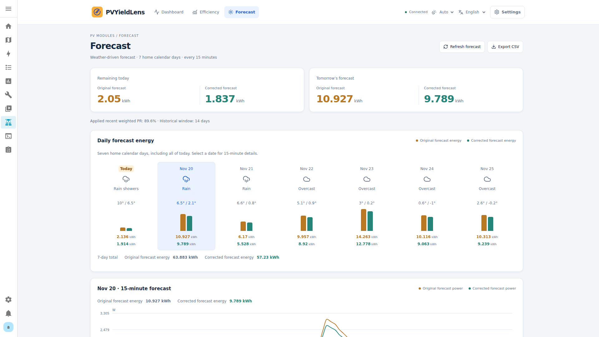

[English](README.md) | **中文** | [Français](README.fr.md) | [Deutsch](README.de.md) | [Polski](README.pl.md) | [Italiano](README.it.md)

# PVYieldLens

## 概览

PVYieldLens 是一款用于在 Home Assistant 中监测光伏发电的应用。它根据组件受到的光照和组件温度算出预估功率，再与传感器测到的实际功率对比。性能比（PR）表示实际发电达到了预估值的百分之多少，方便你在不同天气下比较发电表现。

应用会显示当前发电功率，按天对比实际电量和预估电量，并向 Home Assistant 提供实时 PR、今日预估电量等传感器。

发电预测覆盖今天和接下来六天，也会单独给出今天剩余时间的预计电量。对于使用单台光伏逆变器的系统，PVYieldLens 还提供 EMHASS 可读取的 CSV 功率预测，帮助安排家中电器的运行时间。[EMHASS 介绍](https://emhass.readthedocs.io/en/stable/main_core_concepts.html)

## 安装

### Home Assistant OS

本应用要求 Home Assistant 2025.9.0 或更新版本。

[](https://my.home-assistant.io/redirect/supervisor_add_addon_repository/?repository_url=https%3A%2F%2Fgithub.com%2Fenecess%2Fha-pvyieldlens%23dev_v0)

1. 点击上方按钮，在 Home Assistant 中确认**添加**。如需手动添加仓库，打开**设置 > 应用 > 安装应用 > ⋮ > 仓库**，输入 `https://github.com/enecess/ha-pvyieldlens#dev_v0`。
2. 在**应用商店**找到 **PVYieldLens**，点击**安装**。
3. 点击**启动**，然后选择**打开网页界面**。

Home Assistant 2026.2 之前的版本请前往**设置 > 加载项 > 加载项商店**，再从 ⋮ 菜单添加仓库。

### Docker

准备一台能访问 Home Assistant 的设备，并在上面安装 Docker 和 Compose。

1. 下载此仓库并进入目录。将 `.env.example` 复制为 `.env`，在 `PVYL_WEB_PASSWORD` 中设置登录密码。
2. 运行 `docker compose up -d --build`。
3. 在 Docker 主机上打开 [localhost:8099](http://localhost:8099)，以 `admin` 为用户名，使用刚设置的密码登录。

如需从其他设备访问，将 `compose.yaml` 中的端口映射从 `127.0.0.1:8099:8099` 改为 `8099:8099`。

## 配置

安装完成后，在 PVYieldLens 中打开**设置**。可以通过分类列表找到下面各项设置。配置前准备好光伏组件规格书，并确认 Home Assistant 中已有发电功率和辐照度传感器。右上角的**语言**菜单可以切换界面语言。

### 连接 Home Assistant

Home Assistant 应用会自动连接。使用 Docker 时，在 **Home Assistant 地址**中填写 Docker 主机能够访问的地址，例如 `http://homeassistant.local:8123`。请使用你实际访问 Home Assistant 的地址和端口。

在 Home Assistant 管理员账号的个人资料中，通过安全设置创建一个长期访问令牌。将令牌粘贴到 PVYieldLens 的**长期访问令牌**一栏。应用需要使用管理员账号的令牌才能在 Home Assistant 中发布输出传感器。[Home Assistant 账号设置](https://www.home-assistant.io/docs/authentication/#managing-account-access)

点击**刷新实体**来检查连接并加载传感器列表。首次设置或修改地址时须填写令牌。如果地址没变，令牌一栏可以留空，应用会继续使用已保存的令牌。

### 光伏组件

| 设置 | 填写内容 |
| --- | --- |
| **STC 下总最大功率** | 将各组件在标准测试条件（STC）下的额定功率相加，单位为 W。例如 10 块 500 W 的组件合计 5,000 W。 |
| **Pmax 温度系数** | 表示组件温度每变动 1 °C 时最大功率的变化比例。填写规格书中的 %/°C 数值，例如 −0.35。 |
| **组件倾角** | 填写组件与水平面的夹角。平放是 0°，垂直安装是 90°。 |
| **组件朝向** | 选择组件面向的方位。选择**自定义**时，从正北（0°）起顺时针填写小于 360° 的角度，例如东南是 135°。 |
| **标称电池片工作温度（NOCT）** | 用来估算电池片会升温到多少。填写规格书中的数值，大于 20 °C 且不超过 80 °C。默认为 45 °C。 |

组件固定安装时，可以选择**固定值**。如果 Home Assistant 已有角度读数，可以为倾角、朝向分别选择 **HA 实体**，并选用以度（°）提供读数的 `sensor.*`、`number.*` 或 `input_number.*`。如果使用会随太阳转动的支架，应用每次更新预测时读取一次角度，再用这组角度计算全部七天的预测。


### 传感器

在各项设置中搜索并选择对应的 Home Assistant 传感器。如果刚添加了传感器，可以回到**连接 Home Assistant**，点击**刷新实体**来更新列表。

| 设置 | 传感器及支持的单位 |
| --- | --- |
| **实际功率** | 选逆变器的光伏发电功率传感器。它的读数表示这一刻的发电功率，单位为 W 或 kW。 |
| **辐照度** | 选测量组件所受光照强度的传感器，单位为 W/m² 或 kW/m²。传感器的安装倾角和朝向应与组件一致。 |
| **组件温度（可选）** | 选直接测量光伏组件温度的传感器，单位为 °C、°F 或 K。没有这个传感器时可以留空，应用会根据 Open-Meteo 提供的气温、辐照度读数和填写的 NOCT 估算组件温度。 |


### 预测

在**设置**的**预测**中检查 **Home Assistant 位置**、**经纬度**和**家庭时区**。应用按经纬度获取当地天气，按家庭时区的午夜划分每天的电量。如果需要修改位置或时区，请在 Home Assistant 中设置。

**历史 PR 天数**决定修正预测时最多往前看多少天的记录。默认为 14 天，可以设为 3 至 90 天。

### 监测设置

点击**监测设置**展开选项。首次配置可以使用默认值。

- **结算间隔**决定应用每隔多久计算并保存这段时间的电量和 PR。默认为每 5 分钟，可以改为每 1 分钟或 10 分钟。
- **平均时长**决定实时数值取最近多久的读数来算平均值。默认为 60 秒。设得越长，曲线受短时间波动的影响就越小。
- **更新间隔**决定页面每隔多久更新一次实时数值。默认为 5 秒。
- **数据超时**决定传感器上一条读数可以用多久。超过设定时间还没有收到新读数时，应用在计算功率、电量和 PR 时会跳过这段没有新读数的时间。

点击**保存配置**。看到**配置已保存**后，打开**看板**检查实时数值。每段监测时间结束后，应用就会把这段时间的结果加到当天的图表中。

## 可查看的结果

### 看板

看板顶部并排显示当前的**实际功率**、**预估功率**和 **PR**。**可优化功率**是预估功率减去实际功率，单位为 W。如果结果为负，说明实际功率高于预估。想看两条功率曲线最近 10 分钟的变化，可以查看**实时数据**。


在**发电数据**中，可以结合光照和组件温度看今天的功率变化。图上每个点对应一段已经计算并保存的记录。一整段时间都没有足够的读数可供计算时，图上会留空。如果发电功率读数为零，且其他读数齐全，图上会显示 0。


在**历史发电量**中，可以按天比较实际发了多少电和预估会发多少电，单位都是 kWh。选择 **7 天**或 **30 天**可以快速查看近期记录。选择**自定义**可以指定最多 90 天的日期范围，结束日期最晚为今天。

如果想看过去七个完整的自然日，选择**自定义**，把**结束日期**设为昨天，把**开始日期**设为昨天往前数六天的那一天，然后点击**应用范围**。起止两天都计入这七天。


### 能效

先在**能效**页面顶部选择时间范围。**今天**把今天截至当前时间的 PR 与昨天同一时段的 PR 相比。例如中午 12 点查看时，对比的是两天各自从午夜到中午的记录。**24 小时**从当前时间向前数 24 小时。**7 天**和 **30 天**按 Home Assistant 的时区划分日期，都包含今天。

**区间 PR** 表示所选时间内的实际电量达到了预估电量的百分之多少。**PR 较上期变化**用百分点表示两期 PR 的差值。例如 PR 从 90% 降到 87%，就是下降 3 个百分点。**预估与实际电量差**则用 kWh 显示预估比实际多了多少。

在**今天**视图中，先用 **PR 趋势**找到变化的时段，再到**发电对比**查看同一时段的实际功率和预估功率。选择 **7 天**或 **30 天**时，可以用**每天汇总**比较各天的发电量。要看一天内几点发生了变化，可切到**每 5 分钟**，或你在**监测设置**中选择的间隔。


#### PR 的计算方法

应用先根据组件温度和照到组件上的光照调整额定功率，得到预估功率，再用实际功率或电量与预估值比较。

```text
预估功率 = P_STC × [1 + (K / 100) × (T − 25)] × (G / 1000)
实时 PR = 实际功率 ÷ 预估功率 × 100%
区间 PR = 实际电量 ÷ 预估电量 × 100%
```

| 符号 | 含义 |
| --- | --- |
| `P_STC` | **STC 下总最大功率**（W） |
| `K` | **Pmax 温度系数**（%/°C），填写规格书数值，例如 −0.35。 |
| `T` | 实测或估算的**组件温度**（°C） |
| `G` | 组件平面上的**辐照度**（W/m²） |

计算实时 PR 时，**看板**用的是同一段时间内的实际平均功率和预估平均功率。计算**区间 PR** 时，**能效**总是用相同的时间来累计实际电量和预估电量。例如，某个 5 分钟的记录里只有 4 分钟的读数齐全，两种电量都只算这 4 分钟。

例如，装机功率为 5,000 W、`K = −0.35`、`T = 45 °C`、`G = 800 W/m²` 时，预估功率为 **3,720 W**。实际功率为 **3,348 W** 时，PR 为 **90%**。

实际发电高于预估时，PR 可以超过 100%。如果预估功率或预估电量为零，或者没有足够的读数可供比较，PR 显示 **—**。

### 预测

**原始预测**结合 Open-Meteo 预测的光照、气温和你的组件设置，估算今天及接下来六天的发电量。

**修正预测**会参考最近几天的实际表现来调整原始预测。应用比较这些天的实际电量和预估电量，日期越近，对修正结果的影响越大。应用至少需要三天的记录，每天都有两种电量可供比较，且预估电量大于零。只有已过去的日期会计入这三天。记录还没攒够时，可以先看原始预测，修正值显示 **—**。

想知道从现在到午夜还可能发多少电，看**今日剩余预测**。要提前安排明天的用电，可以看**明日预测**。在**每日预测电量**中，**今天**显示全天的预测，**7 日总量**包含全部七天。点击**刷新预测**可请求更新天气数据。



选择一天，可以在功率曲线上找出预计发电最高的时段，并对比原始和修正后的功率。展开图下方的**每 15 分钟明细**，可以逐段查看功率、电量、辐照度和温度。


#### 导出到 EMHASS

如果你的光伏系统使用单台逆变器，可以将功率预测导入 EMHASS，供它安排用电时使用。

1. 点击**导出 CSV**，在**预测功率序列**中选择原始或修正预测。
2. 按本次优化填写**开始日期**、**开始时间**、**优化步长**和**优化步数**。在预览中检查导出的时间范围是否覆盖本次优化。
3. 点击**下载**，将 `data_weather_forecast.csv` 放入 EMHASS 的 `data_path` 文件夹。在 EMHASS 中设置 `set_use_pv=true` 和 `weather_forecast_method=csv`。[EMHASS 配置说明](pvyieldlens/DOCS.md#export-a-pv-power-forecast-to-emhass)


### Home Assistant 输出传感器

配置完成后，PVYieldLens 会在 Home Assistant 中发布下表中的传感器。你可以把实时 PR 放到仪表盘，也可以在自动化中根据明天的预测电量安排电器的运行时间。

| 指标 | HA 实体名称 | 单位 |
| --- | --- | --- |
| 结算预估功率 | `settled_estimated_power` | W |
| 结算实际功率 | `settled_actual_power` | W |
| 结算 PR | `settled_pr` | % |
| 今日预估电量 | `estimated_energy_today` | kWh |
| 累计预估电量 | `estimated_energy_lifetime` | kWh |
| 实时预估功率 | `live_estimated_power` | W |
| 实时实际功率 | `live_actual_power` | W |
| 实时 PR | `live_pr` | % |
| 实时可优化功率 | `live_optimizable_power` | W |
| 今日预测电量 | `forecast_energy_today` | kWh |
| 今日剩余预测电量 | `forecast_energy_remaining_today` | kWh |
| 明日预测电量 | `forecast_energy_tomorrow` | kWh |
| 七天预测电量 | `forecast_energy_7d` | kWh |

表中是 Home Assistant 显示的实体名称。在自动化中要用完整的实体 ID，例如 `sensor.pvyieldlens_settled_estimated_power`。带“结算”的传感器提供最近一段已经保存的结果，实时传感器随**看板**上的平均值更新。

今日预估电量在家庭时区的午夜归零，累计预估电量从首次配置开始累加。四个预测传感器提供的都是以 kWh 计的**原始预测**电量，数值可能随预测更新而变化。
